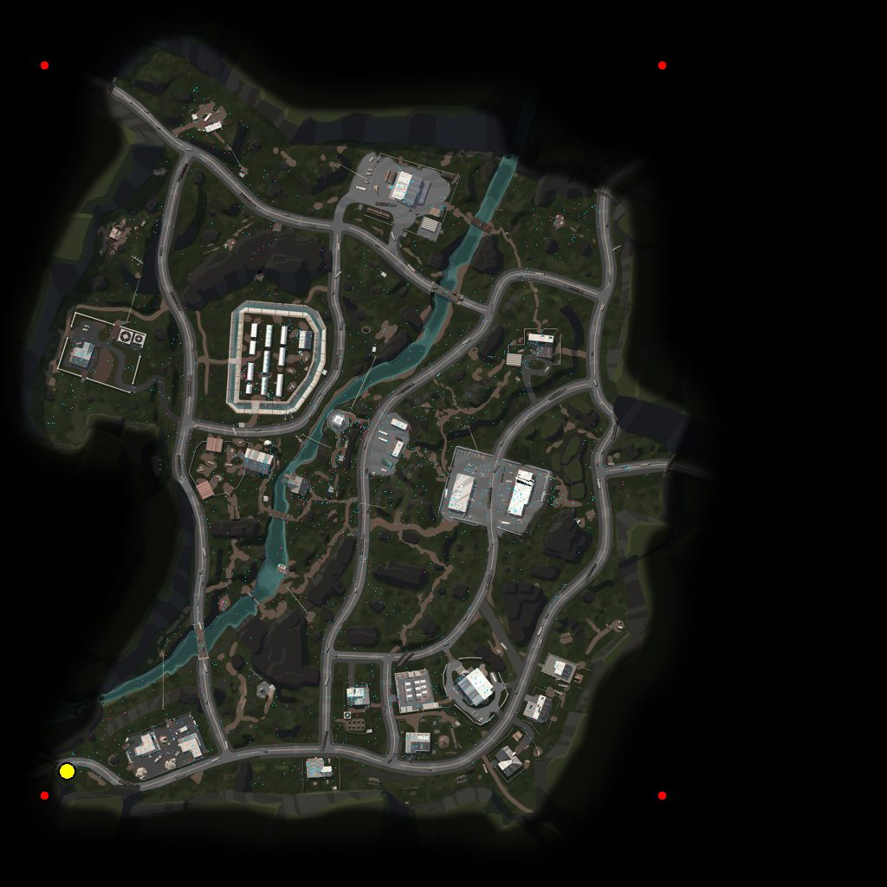

# Architecture

## What I built with, and why

- **Frontend:** React 18 + TypeScript + Vite 7. Journeys/heatmaps are hand-drawn
  on stacked `<canvas>` over the minimap `` — no map or charting library
  (the minimap is a fixed image in a known 1024-px space; a mapping stack would
  be weight with no payoff).
- **In-browser pipeline:** [DuckDB-WASM](https://duckdb.org/docs/api/wasm/overview)
  (reads the `.nakama-0` Parquet files, does the grouping in SQL), JSZip
  (unpack), a TS port of the classification/coord/timestamp logic, `idb`
  (IndexedDB). Only the `eh` wasm build ships (34 MB / ~8 MB gzip), bundled
  locally (no CDN) and code-split — it loads only when the first zip is dropped.
- **Offline pipeline (twin):** the same logic in Python + DuckDB
  (`pipeline/build.py`). Used to bake an optional bundled dataset, for CI, and as
  the parity reference. Verified: on the sample data it and the browser pipeline
  produce **identical** manifest counts and match content (paths, events,
  timestamps, pixel coords).
- **Hosting:** a static `dist/` folder. No backend, database, or upload endpoint.

**Why the pipeline runs in the browser.** A Level Designer needs to open one link
and load a fresh `month_x.zip` themselves, with nothing to maintain. A server
that unzips + analyses uploads would be a thing to keep alive, and a free-tier
instance cold-starting or sleeping lands exactly when a reviewer clicks the link.
The 5-day sample is ~89 K rows and DuckDB-WASM crunches it in a few seconds in a
tab; a monthly batch is a handful of times that — still comfortably in-tab. So
the browser does the whole pipeline and the site stays a static upload.

Trade-off accepted: a genuinely huge dataset (many GB) would strain a tab — for
that, `pipeline/build.py` is the escape hatch, and its output can be shipped as
the bundled dataset.

## How data flows from Parquet to screen

```
                    ┌─ user drops month_x.zip (or several) ─┐
                    ▼                                        │
  JSZip: extract *.nakama-0 buffers + minimaps/ images      │  bulk upload:
                    ▼                                        │  each zip -> one
  DuckDB-WASM: read_parquet([...], filename=true)            │  Dataset, plus a
    epoch_ms(ts), CAST(event AS VARCHAR)                     │  "Combined" merge
                    ▼                                        │
  TS pipeline (mirror of pipeline/lib.py + build.py):        │
    user_id shape -> human | bot                             │
    world (x,z) -> minimap pixel   |   ts×1000 -> real ms    │
    group by match_id -> players[]{ path[], events[] }       │
    bin kill/death/traffic into 96×96 grids, split per day   │
  createImageBitmap: minimap image -> 1024² WebP blob        │
                    ▼                                        │
  Dataset { manifest, matches:Map, heatmaps:Map,             │
            minimaps:Map<MapId,Blob>, warnings[] }  ─────────┘
                    ▼
  IndexedDB (persist, local only)   ──►   App state (active dataset)
                    ▼
  Controls · MapCanvas (canvas over minimap) · Timeline
```

Optional bundled branch: if `web/public/data/` exists (someone ran
`pipeline/build.py` / the Docker pipeline, or a deploy shipped with data), the
app `fetch()`es it on boot as a read-only "Bundled dataset". Absent by default —
the repo ships **no** data.

Everything downstream of `Dataset` is one shape: `manifest` feeds the dropdowns,
`matches.get(id)` and `heatmaps.get(map_kind)` are synchronous lookups.

## Mapping game coordinates to the minimap

World `x`/`z` → pixels (`y` is elevation, unused), per the dataset README, done
identically in `pipeline/lib.py` and `web/src/lib/pipeline/constants.ts`:

```
u = (x - origin_x) / scale
v = (z - origin_z) / scale
pixel_x = u * 1024
pixel_y = (1 - v) * 1024          # image origin is top-left; world +z is "up"
```

| Map | scale | origin_x | origin_z |
|---|---|---|---|
| AmbroseValley | 900 | −370 | −473 |
| GrandRift | 581 | −290 | −290 |
| Lockdown | 1000 | −500 | −500 |

**Verified** by `pipeline/verify_coords.py`: (1) the README's worked example,
world `(-301.45, -355.55)` on AmbroseValley → pixel `(78, 890)`, exact; (2) a few
thousand real position samples plotted onto each minimap all land on roads and
structures inside the playable island. The pipeline emits coords in this fixed
1024 space; the canvas scales by `size / 1024`, so rendering is
resolution-independent.



*`verify_coords.py` output for AmbroseValley — the README's worked example
(yellow), the data's world-bounding-box corners (red), and thousands of real
`Position` / `BotPosition` samples (cyan/pink). Everything lands on the playable
island, on roads and structures.*

## Timestamp handling

`ts` is `timestamp[ms]`, but one match spans only ~700 units and the absolute
values only fall in Feb 2026 when ×1000 — the export put *seconds* into a
millisecond field. Both pipelines normalise per match (subtract min) and ×1000.
Recovered match lengths are sane: median 6.4 min, p90 12.

## Assumptions where the data was ambiguous

- **`ts` units** — ×1000 to real ms (above).
- **Human vs bot** — `user_id` shape only (UUID vs numeric), never event name; a
  few bot files carry `Position` rows a name check would misread.
- **Combat event ownership** — an event belongs to the file's owner. `Kill`/
  `BotKill` → that player got a kill (killer position → *kill zones*). `Killed`/
  `BotKilled`/`KilledByStorm` → that player died (victim position → *death
  zones*). Only bot-vs-bot rows are genuinely ambiguous; treated as that bot's.
- **Match date** — from the day folder inside the zip (`February_10`);
  `<Month>_<DD>` is parsed generically, unknown names pass through.
- **Unknown `map_id`** — rows dropped with a warning (no minimap / config); the
  zip may include `minimaps/<Name>` to supply one.
- **Corrupt / truncated files** — the bulk read falls back to a per-file scan
  that isolates, counts and lists each failure as a dataset warning.
- **`y` (elevation)** is ignored — only `x`/`z` map to the 2D minimap.

## Major trade-offs

| Decision | Alternative | Why this way |
|---|---|---|
| Pipeline runs in the browser | Upload endpoint runs it server-side | No host to keep alive; free-tier cold-start hits at review time; dataset is small enough for a tab |
| Two pipeline implementations (TS + Python) | One | Python is the CI/offline/parity twin and bakes the optional bundled dataset; a parity check keeps them honest |
| DuckDB-WASM, `eh` build only, bundled + code-split | Ship both wasm builds; CDN load; hand-rolled Parquet reader | `eh` is universal since 2021 and needs no COOP/COEP; dropping `mvp` halves the deploy (76 → 35 MB); ~8 MB gzip downloads only on first upload |
| Datasets in IndexedDB, local only | Server storage; or session-only | "Nothing is uploaded" holds; a refresh keeps your work |
| Ship no data; upload-driven | Commit the sample | The employer's production data isn't ours to publish; the app is meant to take fresh drops |
| One `Dataset` object, sync lookups | Fetch per match | A month fits in memory; removes all per-match async plumbing |
| `ts` ×1000 → real ms | Raw units, label "ticks" | Raw only makes sense as epoch-ms ÷ 1000; ×1000 matches the README's "several minutes" |
| Hand-rolled canvas | Mapbox / deck.gl / charting lib | Minimap is a fixed image in known pixel space |
