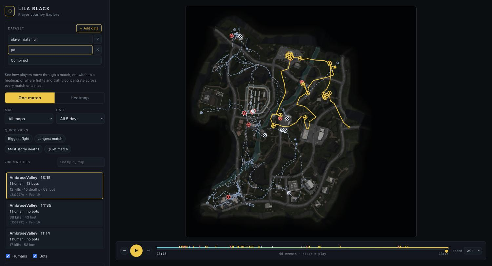

# LILA BLACK — Player Journey Explorer

An interactive web tool for a **Level Designer** to see how players actually move
through LILA BLACK matches: routes on the correct minimap, kill / death / loot /
storm markers, timeline playback, and kill / death / traffic heatmaps.

You drop a `player_data.zip` (or a new `month_x.zip`) onto the page and it's
unpacked and analysed **entirely in your browser** — there is no backend and no
data is uploaded anywhere.

**Live:** _<add deployment URL here>_



---

## What it does

| Requirement | How it's met |
|---|---|
| Load & parse the Parquet data | The browser reads all 1,243 `.nakama-0` files (Parquet under a non-standard extension) with DuckDB-WASM. A Python twin (`pipeline/build.py`) produces byte-identical output for CI / offline / very large datasets. |
| Player journeys on the right minimap, world coords mapped correctly | Per-map `scale`/`origin` → UV → pixel, Y-flipped; verified against the dataset README's worked example and by eye on all three maps |
| Humans vs bots, visually distinct | Humans = solid line, one saturated colour each. Bots = **dashed** line, one muted slate colour. Distinct by **both** colour and line style. |
| Distinct markers for kill / death / loot / storm death | Four separate canvas glyphs, colour-coded, always shown in the legend |
| Filter by map / date / match | Populated from `manifest.json`; match list is searchable and ranked by activity |
| Timeline / playback | Scrubber + play/pause + speed (10–120×). Paths draw up to the current time; markers pop in as playback passes them. Event ticks sit under the scrubber. |
| Heatmap overlays (kills / deaths / traffic) | Precomputed count grids per map, per collection day. Toggle the kind; pick a day or all days. |
| Hosted, shareable link | Fully static build — no backend. Deploys to any static host. |

Getting data in:

- **Drop a `.zip`** (day folders of `*.nakama-0` + a `minimaps/` folder) anywhere on the page — or several at once. Each becomes a **dataset** in a switcher; ≥2 uploads also get a **Combined** view.
- Unpack → analyse → re-encode minimaps all run in the browser (DuckDB-WASM). Progress is shown per zip; unreadable files / unknown maps surface as dataset warnings.
- Processed datasets are cached in **IndexedDB** — a refresh keeps them. Nothing leaves the browser.

Built for the actual user (a Level Designer, not a data scientist):

- Matches are described in plain language — `AmbroseValley · 6:24 · 1 human, 13 bots · 12 kills · 68 loot` — not raw hex IDs.
- **Quick picks**: one click for "Biggest fight", "Longest match", "Most storm deaths", "Quiet match" on the current map/date.
- Players get friendly names (**Human A**, **Bot 3**). Click one in the list — or on the map — to **isolate** just that player's route.
- **Map brightness** slider so the paths and heatmap read clearly over the satellite minimap.
- Timeline: play/pause (**spacebar**), jump to next/previous event, adjustable speed.
- Hover tooltips on every marker and path, an always-visible legend, sane defaults on load (busiest match, whole journey shown), and explicit loading / empty states.

---

## Tech stack

- **Frontend:** React 18 + TypeScript, [Vite](https://vitejs.dev/) 7. Journeys/heatmaps are hand-drawn on stacked HTML `<canvas>` over the minimap image — no charting or map library.
- **In-browser pipeline:** [DuckDB-WASM](https://duckdb.org/docs/api/wasm/overview) (Parquet read + SQL grouping), [JSZip](https://stuk.github.io/jszip/) (unpack), a TS port of the classification/coord/timestamp logic, [`idb`](https://github.com/jakearchibald/idb) (IndexedDB). The DuckDB wasm+worker are bundled locally and **code-split** — the payload (~9 MB gzip) loads only on the first upload.
- **Offline pipeline (twin):** Python 3 + DuckDB + pandas + Pillow (`pipeline/build.py`). Same logic, verified to produce identical output. Used for CI, for a very large dataset, or to bake an optional bundled dataset. One-shot batch job: ~4 s, ~1 GB peak RAM.
- **Hosting:** a static `dist/` — Vercel, Netlify, GitHub Pages, Docker/nginx, or `npx serve`. No backend, no upload endpoint.

---

## Repo layout

```
web/                 React + Vite frontend
  src/lib/pipeline/   in-browser pipeline — DuckDB-WASM, unzip, runPipeline
                      (constants.ts mirrors pipeline/lib.py), minimap re-encode
  src/lib/            datasets.ts (IndexedDB + Combined merge), bundled.ts,
                      types, canvas drawing, palette, match stats
  src/components/     Landing, DatasetBar, Controls, MapCanvas, Timeline, Legend
  src/hooks/          usePlayback
  public/             ships empty; public/data is written by the Python pipeline (git-ignored)
  eslint.config.js / .prettierrc.json / Dockerfile / nginx.conf
pipeline/            Python twin: parse Parquet -> static JSON + compressed minimaps
  lib.py             coord mapping, human/bot detection, event classification
  build.py           entrypoint (env: PLAYER_DATA_DIR, OUTPUT_DIR, DATASET_YEAR)
  verify_coords.py   renders sample points onto each minimap for a visual check
  pyproject.toml (ruff) / requirements*.txt / Dockerfile
docker-compose.yml   `up web` serves the site; `run --rm pipeline` bakes a bundled dataset
Makefile             make help / dev / build / lint / format / check / docker-serve / data
.github/workflows/   ci.yml (lint + typecheck + build + docker), deploy.yml (Pages)
ARCHITECTURE.md      one-page design: what/why, data flow, coord walkthrough, trade-offs
INSIGHTS.md          three findings from the data, each with a stat and a level-design takeaway
```

---

## Running it

`make help` at the root lists every target. The rest of this section is what
they do.

### 1. Frontend (all you need)

```bash
cd web
npm install
npm run dev      # http://localhost:5173
npm run build    # -> web/dist  (static, deploy this)
npm run preview  # serve the production build locally
```

**Node 20+** (Vite 7). No environment variables — no backend, nothing to
configure. `vite.config.ts` sets `base: "./"` so the build works at a domain root
or any sub-path. The app opens on a drop zone; drop `player_data.zip` (or your
own `month_x.zip`) and it processes in the tab.

### 2. Python pipeline (optional)

The browser does the pipeline, so this is only for CI, a very large dataset, or
to bake a bundled dataset the app loads on boot (writes to `web/public/data`).
Output is byte-identical to the browser's.

```bash
python3 -m venv .venv
./.venv/bin/pip install -r pipeline/requirements-dev.txt
PLAYER_DATA_DIR=/path/to/player_data ./.venv/bin/python pipeline/build.py
#   or:  make data PLAYER_DATA_DIR=/path/to/player_data
```

| Env var | Default | Meaning |
|---|---|---|
| `PLAYER_DATA_DIR` | `~/Downloads/player_data` | raw dataset root — day folders + `minimaps/` |
| `OUTPUT_DIR` | `web/public` | where `data/` and `minimaps/` are written |
| `DATASET_YEAR` | `2026` | year for the `<Month>_<DD>` folders |

Day folders are auto-discovered (any sub-directory with `*.nakama-0`), so a new
`March_01/…` drop-in needs no code change. `build.py` prints a summary and lists
any unreadable files in `pipeline/_verify/skipped.txt` (currently none — all
1,243 parse). `verify_coords.py` renders the coordinate-mapping check overlays.

### 3. Docker

```bash
docker compose up --build web        # site on http://localhost:8080
PLAYER_DATA_DIR=/abs/path/to/player_data \
  docker compose run --rm pipeline   # bake web/public/data as a bundled dataset
```

`web/Dockerfile` is a multi-stage build (Node build → nginx serving `dist/`).
`pipeline/Dockerfile` runs `build.py` against `/data` (mounted read-only) → `/out`.
On **Linux** the pipeline container runs at native speed; on **macOS** the
bind-mount read of 1,243 small files is slow (~2–3 min) — the browser or native
`make data` is faster for local work.

---

## Deployment

Any static host. The build output is `web/dist/`.

- **Vercel:** import the repo, set **Root Directory** to `web`, framework preset
  *Vite*. Build `npm run build`, output `dist`. No env vars.
- **Netlify:** base `web`, build `npm run build`, publish `web/dist`.
- **GitHub Pages:** see `.github/workflows/deploy.yml` (builds `web/` and publishes
  `dist/` on push to `main`).
- **Docker / any container host:** `web/Dockerfile` → an ~50 MB nginx image.

---

## Code quality

| Area | Tool | Command |
|---|---|---|
| Frontend lint | ESLint 9 (flat config) + `typescript-eslint` + react-hooks | `npm run lint` |
| Frontend format | Prettier | `npm run format` / `npm run format:check` |
| Frontend types | `tsc --noEmit`, `strict: true` | `npm run typecheck` |
| Pipeline lint + format | Ruff (`E`, `F`, `W`, `I`, `UP`, `B`, `SIM`, `C4`) | `ruff check pipeline` / `ruff format pipeline` |

`make check` runs all of it (lint + format-check + typecheck + build + ruff) —
the same set `.github/workflows/ci.yml` runs on every push and PR, alongside a
`docker build` of both images. `.editorconfig` covers indentation for editors.

---

## Assumptions & edge cases

These are the places the data was ambiguous and a call had to be made. They're
also in `ARCHITECTURE.md`; repeated here so nothing is buried.

- **`ts` units.** The `ts` column is a `timestamp[ms]`, but a whole match spans
  only ~700 of those units. Reading the absolute values as real epoch
  milliseconds puts them in Feb 2026 only if multiplied by 1000 — i.e. the export
  stored *seconds* into a millisecond field. The pipeline normalises per match
  (subtract the match's min `ts`) and multiplies by **1000** to recover real
  elapsed time. This gives sensible match lengths (median **6.4 min**, p90 12).
- **Human vs bot** is decided **only** by the `user_id` shape: a UUID is a human,
  a short numeric id is a bot. Event names are *not* used for this (a handful of
  bot files contain `Position`/`Loot` rows; they stay classified as bots).
- **Combat event ownership.** `Kill`/`BotKill` in a file = that file's player got
  a kill (plotted at the killer's position → *kill zones*). `Killed`/`BotKilled`/
  `KilledByStorm` = that player died (plotted at the victim's position → *death
  zones*). The dataset README phrases `BotKilled` as "killed by a bot"; under the
  file-owner rule that still means the file's owner died, so the two agree. The
  only genuinely ambiguous rows are `BotKill`/`BotKilled` inside *bot* files
  (bot-vs-bot); those are treated as that bot's kill / death.
- **Heatmap date filtering** is supported and exact: counts are bucketed per
  collection day and summed for the selected range on the client.
- **February 14 is a partial day** (collection was ongoing) — it is included and
  labelled; its lower counts are expected, not a bug.
- **Map per match** is the modal `map_id` across the match's rows (always
  consistent here). A match_id under two day folders is assigned the earlier day.
- **Unknown `map_id`** — rows are dropped with a dataset warning (no minimap /
  config). A zip may include `minimaps/<Name>` to supply the image.
- **Corrupt / truncated files:** both pipelines read the whole set in one query;
  if that throws they fall back to a per-file scan that isolates, counts and
  lists each failure (a dataset warning in the browser,
  `pipeline/_verify/skipped.txt` offline). None fail on the current dataset.
- **`y` (elevation)** is ignored for plotting, as instructed — only `x`/`z` map to
  the 2D minimap.
